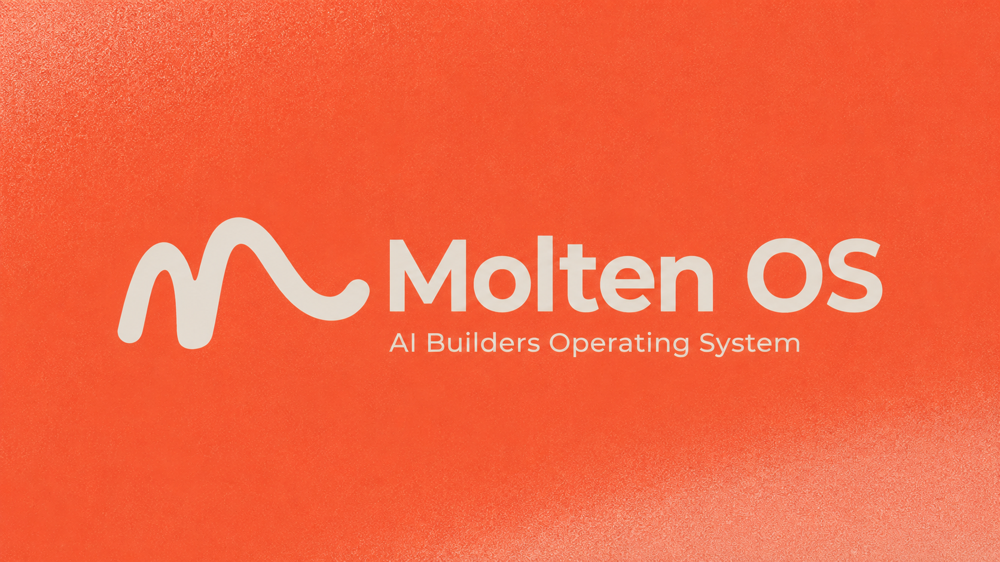
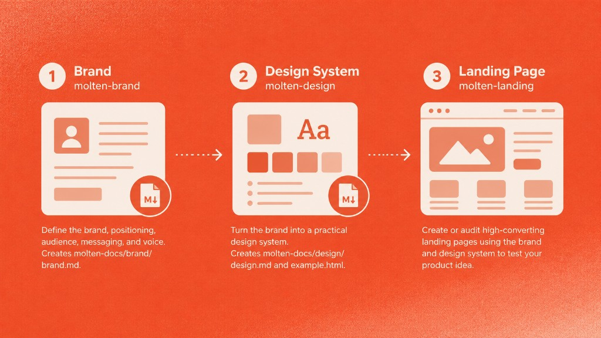

# Molten OS Core - Idea in, shipped feature out



### Validate the idea, give it a brand and a landing page, then build it with your coding agent using a disciplined loop: discovery, spec, plan, build, verify, review.

Molten OS Core is a set of AI agent skills from [Switch Dimension](https://switchdimension.com) and AI builder YouTuber [Rob Shocks](https://youtube.com/robshocks). It covers the two places most AI-built products go wrong:

- **Building the wrong thing.** The product skills challenge the idea first, then turn the strongest version into a brand, a design system and a landing page you can test with real people.
- **Building it badly.** The Agent Development Loop stops your coding agent from jumping straight to code. It interviews you, writes a testable spec and a plan, builds in thin tested slices, proves every acceptance criterion and reviews the change before it merges.

Drop this prompt into your AI agent to get started:

```
install all the skills in this repo to my project - https://github.com/switch-dimension/molten-os-core
```

Not sure where to start? Ask your agent to run **mt-guide**. It reads your `molten-docs/` folder, tells you where you are and recommends the next skill.

> Released under the MIT license — copy it, fork it, and use it as inspiration for your own evolving system. [Full install options below.](#installation)

## What you get

Every skill writes its output as Markdown under `molten-docs/`, so each step builds on the last and you (or another agent) can pick up where you left off.

| Group | Skills | Use it when |
| --- | --- | --- |
| **Agent Development Loop** | mt-discovery → mt-spec → mt-plan → mt-build → mt-verify → mt-review, plus optional mt-prototype and mt-mockup | You're building a feature or product with a coding agent |
| **Product skills** | mt-validate → mt-brand → mt-design → mt-landing | You have an idea and want to test it with real people before building |
| **Utility skills** | mt-guide, mt-search, mt-skill-manage | Any time. Start with **mt-guide** if you're unsure which skill to use |

## Agent Development Loop

A vague request that goes straight to code produces the wrong thing quickly. The loop adds a few minutes of thinking up front and hard evidence at the end, so what your agent ships matches what you meant.

```
                 ┌─ mt-prototype (optional) ─┐
mt-discovery ────┤                           ├──► mt-spec ─► mt-plan ─► mt-build ─► mt-verify ─► mt-review
                 └─ mt-mockup    (optional) ─┘
```

### Core steps

Run these in order.

| Step | Skill | What it does for you |
| --- | --- | --- |
| 1 | **mt-discovery** | Interviews you before any code is written: goals, users, constraints, codebase context and the riskiest unknown. Writes `molten-docs/discovery/<slug>.md`. |
| 2 | **mt-spec** | Turns discovery (and any prototype or mockup learnings) into a testable spec with acceptance criteria, data shape, edge cases and non-goals. Writes `molten-docs/spec/<slug>.md`. |
| 3 | **mt-plan** | Breaks the approved spec into ordered vertical-slice tasks with checkpoints. Writes `molten-docs/plan/<slug>.md`. |
| 4 | **mt-build** | Implements the plan one slice at a time with a lightweight red-green-refactor loop, keeping the app runnable. |
| 5 | **mt-verify** | Checks every acceptance criterion against evidence (tests, the real app) and debugs failures from root cause. Writes `molten-docs/verify/<slug>.md`. |
| 6 | **mt-review** | Reviews the change before it merges for correctness, readability, architecture, security and performance, with severity-labelled findings. Writes `molten-docs/review/<slug>.md`. |

### Optional steps

Use these between discovery and spec only when they earn their cost. If the shape is already clear, go straight to **mt-spec**.

| Skill | Use it when | What it does for you |
| --- | --- | --- |
| **mt-prototype** | One question is still risky, usually technical feasibility or a single tricky interaction | Builds the smallest throwaway thing that answers it, then records what was learned in `molten-docs/prototype/<slug>.md`. |
| **mt-mockup** | You want to see and click through the whole UX before paying for backend work | Builds a clickable, frontend-only mockup with mocked JSON and a fake API. Choose throwaway (`molten-docs/mockup/<slug>/`) or scaffold real pages in your app. |

## Product skills

Turn a raw idea into a validated landing page you can test with real people — score, brand, design system and page — in an afternoon, not a quarter.



Run these in order.

| Step | Skill | What it does for you |
| --- | --- | --- |
| 1 | **mt-validate** | Adversarially scores a product idea with quick, full-interview or re-validation modes and names the riskiest assumption to test. Writes `molten-docs/validate/product-score-N.md`. |
| 2 | **mt-brand** | Pins down who you're for, the pain you solve, your positioning, message and voice. Writes `molten-docs/brand/brand.md`. |
| 3 | **mt-design** | Turns that brand into a practical design system for one surface at a time (landing, web, mobile or desktop) plus a live visual preview. Writes `molten-docs/design/design.md`. |
| 4 | **mt-landing** | Creates (or audits) a high-converting landing page from your brand and design system, so you can test the idea with an audience fast. |

### Why validate before building?

A good validation pass and landing page are sharper tests than a pitch deck or a business plan, because they force you to answer the questions that decide whether a product works:

- **Who** is this for?
- **What** pain are they feeling?
- **Why** does that pain matter to them right now?
- **How** do the benefits of your product remove it?

Add a waitlist or a paid pre-order and you get the only feedback that counts: will people act? You learn that **before** you commit months to building the wrong thing.

## How the two fit together

The product skills and the dev loop share the same `molten-docs/` folder, so they hand off naturally:

1. **Validate and test the idea**: mt-validate → mt-brand → mt-design → mt-landing.
2. **Build the product**: run the Agent Development Loop once per feature. mt-discovery, mt-prototype, mt-mockup and mt-spec pick up `brand.md` and `design.md` when they exist, so what you build matches what you tested.

You don't need both. Use the dev loop on its own in any existing codebase, or the product skills on their own to test an idea.

## Utility skills

Cross-cutting helpers. Install and use as needed.

| Skill | What it does for you |
| --- | --- |
| **mt-guide** | The "start here" router. Reads `molten-docs/` to show where each feature is and what comes next, or asks a few questions and recommends the right skill, including shortcuts for small fixes, bugs and reviews. |
| **mt-search** | Routes search and research queries to the right backend: quick web lookup, recent social pulse, platform-specific fetch or cited web research. Handy during validation and discovery. |
| **mt-skill-manage** | Manages skills via the skills.sh CLI (`npx skills`): install, update, remove, list and find skills. |

## Installation

Paste this repo into your agent with the prompt above, or install manually with the [skills.sh](https://github.com/vercel-labs/skills) CLI.

Install all skills:

```bash
npx skills add switch-dimension/molten-os-core
```

Install the Agent Development Loop only, plus mt-guide (drop `mt-prototype` and `mt-mockup` if you don't want the optional steps):

```bash
npx skills add switch-dimension/molten-os-core --skill mt-guide mt-discovery mt-prototype mt-mockup mt-spec mt-plan mt-build mt-verify mt-review
```

Install product skills only, plus mt-guide:

```bash
npx skills add switch-dimension/molten-os-core --skill mt-guide mt-validate mt-brand mt-design mt-landing
```

Install utility skills only:

```bash
npx skills add switch-dimension/molten-os-core --skill mt-guide mt-search mt-skill-manage
```

Install a single skill:

```bash
npx skills add switch-dimension/molten-os-core --skill mt-landing
```

All skills use the **`mt-<name>`** convention so they are easy to distinguish from third-party skills in `npx skills ls`.

## Changelog

Release history and version notes: [CHANGELOG.md](CHANGELOG.md). Current release: **v1.3.1**.

## License

Released under the [MIT License](LICENSE). You may use, copy, modify, merge, publish, distribute, sublicense, and sell copies, provided the license and copyright notice are included in redistributions.
